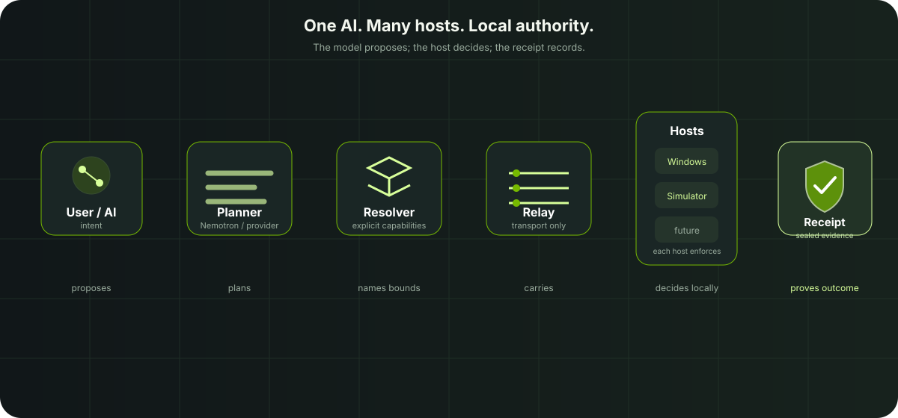
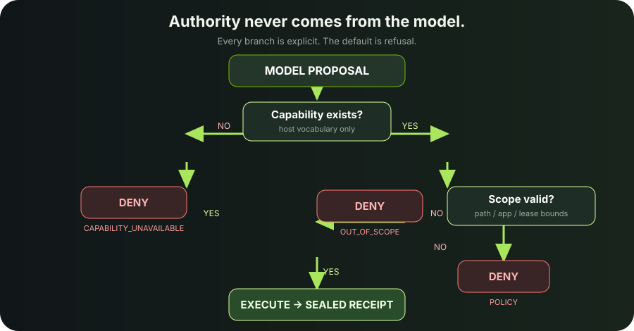
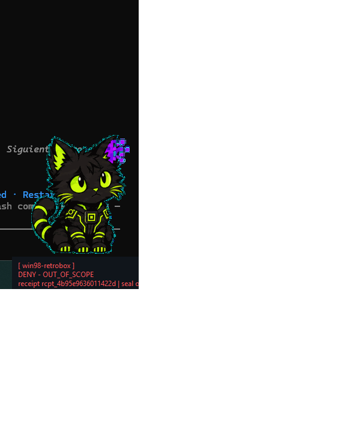
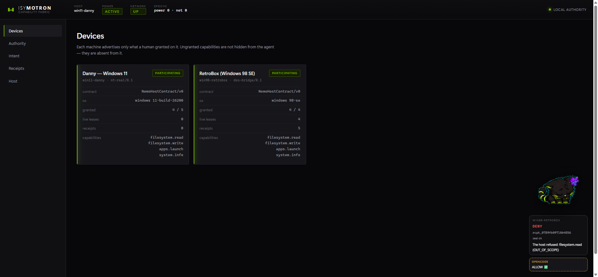

<div align="center">
  

  # ISyMotron

  ### Give AI useful hands — without giving it the keys.

  **A local-first control room where AI proposes, your host decides, and every action leaves evidence.**

  [](https://github.com/DannyBaanks/IsyMotron/actions/workflows/ci.yml)
  [](LICENSE)
  [](https://github.com/DannyBaanks/IsyMotron/releases)
  [](https://nebiusglobalaihackathon.devpost.com/)

  <sub>Built for the <a href="https://nebiusglobalaihackathon.devpost.com/">Nebius × NVIDIA Global AI Hackathon</a>.</sub>
</div>

## The product

AI can reason about what you want. It should not silently become the owner of your computer.

ISyMotron is a control layer for AI agents that need to work with real devices. It turns a vague request into a clear proposal, checks that proposal against permissions held by a local host, and records what actually happened. The model can suggest. The host decides. The evidence stays inspectable.

That makes the experience feel less like handing an AI a terminal and more like giving it a carefully bounded set of tools with a visible approval trail.

## See the idea in one minute

```text
You ask for something useful
            ↓
AI creates a typed proposal
            ↓
Your local host checks capability + scope + policy
            ↓
The action is allowed or denied locally
            ↓
A verifiable receipt records the outcome
```

The important part is the boundary in the middle: the model never gets to invent a capability, widen a scope, or turn a suggestion into authority.

## Why this matters

Most agent demos make the happy path look effortless. The harder product question is: **what happens when the agent asks for too much?**

ISyMotron makes that moment part of the user experience. A request outside the allowed scope is denied, the protected payload is not returned, and the refusal is still recorded. Users do not have to trust a green checkmark or a model-generated sentence; they can inspect the decision and reproduce the evidence.

## Built for real devices, not just a chat window

ISyMotron connects an agent to a small, explicit capability fabric:

- Read or write only inside granted filesystem roots.
- Inspect processes without granting process control.
- Launch only allowlisted applications.
- Read bounded system facts.
- Keep the decision boundary on the host that owns the data.

The same product idea is carried across Windows, Linux and macOS host engines, with platform differences recorded instead of hidden behind a generic “works everywhere” claim.

<div align="center">
  
</div>

## What makes the infrastructure different

### Nebius Token Factory + NVIDIA Nemotron

The planning layer uses NVIDIA Nemotron served through Nebius Token Factory. The model handles intent and planning; it does not own the grants or the enforcement boundary. A live, sealed run is preserved in [`evidence/M3/RUN.md`](evidence/M3/RUN.md), including a successful plan and an adversarial refusal.

### Local authority, transport-only relay

The relay moves requests. It does not grant access. The host checks the request locally against capability, scope, leases and policy before anything runs.

### Receipts that are more than a badge

A receipt records the decision, result and anchored inputs. The verification path re-derives the decision instead of trusting a self-asserted “verified” label. Both `ALLOW` and `DENY` outcomes are part of the evidence trail.

### Cross-platform engineering

The project has real host engines and CI coverage for Windows, Linux and macOS. The reference host exercises Windows filesystem semantics and process state; Linux and macOS prove portability within their documented scope. Packaged builds are smoke-tested, hashed and attested in the release workflow.

<div align="center">
  
</div>

## A product experience, not a security lecture

The new web control room is designed for people who should not need to understand every internal term before they can use the product. It gives them:

- A calm overview of connection, local authority, data freshness and evidence.
- A human-readable capability catalog with technical identifiers available when needed.
- A clear path from proposal to decision to receipt.
- Explicit demo, disconnected, empty and error states.
- Progressive disclosure for technical details instead of forcing everyone into a console.
- Malbolgato as a read-only companion that represents the system without pretending to authorize it.

<p align="center">
  
  
</p>

### Malbolgato: the companion with a hard boundary

Malbolgato makes the system more approachable, but it is deliberately not a trust shortcut. It can open the companion surface and reflect state from the authorized channel. It cannot grant permissions, execute actions, mint receipts or turn chat text into evidence.

<p align="center">
  
</p>

## A real demo path

The demo is intentionally short and testable:

1. Grant a narrow capability, such as reading one logical host root.
2. Let Nemotron propose a typed request through Nebius Token Factory.
3. Execute an in-scope action and receive `ALLOW` plus observed output.
4. Try an out-of-scope action and receive `DENY` without the protected payload.
5. Inspect the receipt and verify the anchored evidence.

The public demonstration video is available here:

**[Watch the real ISyMotron demo on YouTube](https://youtu.be/CXpOxUFJMrI)**

It shows a live plan where Nemotron proposes, the host decides, and receipts record the outcome.

### Hosted demo

**[Open the hosted ISyMotron console](https://isymotron-production.up.railway.app)**

The hosted version is a zero-local-state demonstration with a simulated fixture host. It is designed for quick evaluation: you can follow the proposal, decision and receipt flow without connecting a personal computer.

## What is demonstrated today

The repository contains runnable evidence for the following claims:

- Deny-by-default capabilities with scopes, leases and sealed receipts.
- Real filesystem and process surfaces on a Windows host.
- A real Linux host with the same contract, plus platform-specific hardening.
- A scoped macOS host engine gated in CI.
- Planner refusal of hallucinated or ungranted capabilities.
- Live Nemotron planning through Nebius Token Factory.
- A read-only avatar authority channel with adversarial tests.
- Receipt re-derivation through the Quine Gate.
- Packaged builds, checksums, attestations and smoke tests.

The full evidence vocabulary is intentionally more precise than marketing language. Read [`docs/EVIDENCE.md`](docs/EVIDENCE.md) for the claim-by-claim record and its limits.

## Try it

### Fastest path: run the local demo

```bash
git clone https://github.com/DannyBaanks/IsyMotron.git
cd IsyMotron
python3 -m console --demo-host
```

The demo host keeps the flow reproducible. It lets you see the proposal, local decision, execution result and receipt without giving the model unrestricted access to your computer.

### Optional Nebius + Nemotron planning

Set your Nebius Token Factory key and choose the provider:

```bash
export ISYMOTRON_PROVIDER=nebius
export NEBIUS_API_KEY="..."
python3 -m console
```

The default hackathon path uses NVIDIA Nemotron through Nebius Token Factory. NVIDIA NIM and local providers such as Ollama and llama.cpp use the same planner seam; the provider changes how a proposal is produced, not what the host is allowed to do.

### Desktop builds

Prebuilt Windows, Linux and macOS packages are published in [GitHub Releases](https://github.com/DannyBaanks/IsyMotron/releases). The release artifacts include checksums and attestations. From source, the runtime uses the Python standard library; development checks are documented in [`requirements-dev.txt`](requirements-dev.txt).

## Repository guide

The product surface is intentionally easy to enter. The deeper guarantees live in focused documents:

- [`docs/ARCHITECTURE.md`](docs/ARCHITECTURE.md) — how the system fits together.
- [`docs/CLI.md`](docs/CLI.md) — the command-line entry points and demo commands.
- [`docs/EVIDENCE.md`](docs/EVIDENCE.md) — what is demonstrated and what is not.
- [`docs/AVATAR_CONTRACT.md`](docs/AVATAR_CONTRACT.md) — why Malbolgato is representation, never authority.
- [`docs/GUS_WEB_ENDPOINT.md`](docs/GUS_WEB_ENDPOINT.md) — safe design for a future GUS web endpoint.
- [`docs/QUINE_GATE.md`](docs/QUINE_GATE.md) — how receipt verification is reproduced.
- [`docs/PLATFORM_SUPPORT.md`](docs/PLATFORM_SUPPORT.md) — platform scope and parity.
- [`docs/PROVIDERS.md`](docs/PROVIDERS.md) — provider seams and local model options.
- [`web/`](web/) — the optional Next.js control-room frontend.
- [`tests/`](tests/) — contract, host, planner, console and adversarial gates.
- [`evidence/`](evidence/) — sealed runs and screenshots.

The README is the product story. Security contracts, threat boundaries and platform limitations remain explicit in the linked documents rather than being hidden or flattened into a marketing claim.

## Hackathon alignment

ISyMotron is submitted to the **Best Apps and Agents** track of the [Nebius × NVIDIA Global AI Hackathon](https://nebiusglobalaihackathon.devpost.com/). The project is built around the challenge requirements: a working application using an NVIDIA open model through Nebius infrastructure, a public repository, a runnable demo path and a short public demonstration video.

The project uses Nebius Token Factory for live Nemotron planning. Our feedback is grounded in a real application rather than a benchmark: Token Factory gives the planning layer a fast path to an open NVIDIA model, while the host contract keeps the resulting system bounded and inspectable.

The hackathon judges evaluate technological implementation, design, potential impact and quality of the idea. ISyMotron is designed to be legible on all four dimensions: a real cross-platform system, a calmer product surface, a concrete problem for agent safety and a non-obvious answer to the question of how AI should act on real devices.

## License

ISyMotron is released under the [MIT License](LICENSE).

## Asset provenance

README artwork and evidence screenshots are catalogued in [`docs/assets/PROVENANCE.md`](docs/assets/PROVENANCE.md). The hero is a product illustration, not a screenshot, benchmark or proof of execution. The screenshots and GIFs in this README come from the repository's real console/avatar evidence.
